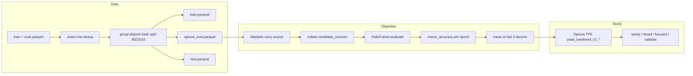

# 22. V2 HPO Data Protocol and Macro-Averaged Objective

- **Status**: Accepted
- **Date**: 2026-10-14

## Context

All Optuna studies to date (broad, narrow, focused) ran before the M1-M4
hardening and the Nimble target fix, and their objective was compromised at the
data layer. `split_parquet_dataset` (ADR-0015) takes contiguous slices of
source-grouped parquet files, so eval slices were single-source (100%
dwidlee_gen at 16k samples, 100% dwidlee_p2 at full data). `eval.parquet` is
53.8% contaminated by exact `(query, choices, target)` duplicates of train rows
(95.4% label agreement), and `train.parquet` has 5.04x within-file group
duplication (299,423 rows -> 59,366 unique groups). The observed 36.5% plateau
equals the eval slice's const-predictor rate `P(target==0)` — a dead knowledge
gate scores the label prior — so the old objective mostly measured memorization
headroom, and every hyperparameter showed |r| < 0.12 against it. A council of
five models (2026-10-14) set the conditions for the next study; the user
approved implementing all of them.

## Decision

The next HPO experiment runs on a new, fixed data protocol and objective:

1. **Group-disjoint hash split** (`experiments/prepare_hpo_split.py`): pool the
   train+eval parquet files, exact-row dedup, split unit = (whitespace-normalized
   query, choices) group, sha256 hash assignment (80/10/10), group-disjointness
   asserted before writing. Writes `data/processed/v2/{train,optuna_eval,test}.parquet`
   plus split metadata (per-source const-predictor rates, chance rates, and the
   derived collapse threshold = macro const-predictor + 0.02).
2. **Macro-averaged per-source eval accuracy** as the objective, aggregated as
   the mean of the last two epochs (`macro_accuracy`, `mean_last2`). Best-epoch
   selection is reserved for Phase-D validation on the locked test split.
   `source` is plumbed through both datasets and the collator (per-sample
   `sources`, per-candidate-row `candidate_sources`); collapse pruning keys on
   the macro metric so per-source positional bias cannot mask collapse.
3. **Explicit-path harness**: studies pass train/eval/test paths and every
   hyperparameter explicitly — never CLI defaults, several of which exceed the
   realigned caps (`--lr` 1e-3, `--decisiveness-weight` 0.1). `min_lr` is wired
   to `lr/100` because the scheduler's single scalar `eta_min` would otherwise
   invert the cosine floor for `lr < 1e-4`. `logit_scale` is exposed via
   `--logit-scale` and scanned.
4. **Phased study** (`experiments/optuna_study_v2.py`):
   sanity (anchor x 5 seeds) -> broad (300 trials) -> focused (2-D probes) ->
   validate (top-K x fixed seeds on the locked test split). The pre-M4
   focused/narrow studies are retired to `experiments/retired/`.

The v2 HPO pipeline: group-disjoint splits feed a source-aware objective, which
feeds the phased study; `test.parquet` is touched only in the validate phase.

Alternatives considered and rejected: reusing `eval.parquet` as-is (53.8%
contamination); best-epoch as the objective (max-of-8 selection bias of roughly
+1.5-2.5 points); scanning `min_lr` freely (it is coupled to `lr`; wired
instead); resuming the old studies (their TPE priors were fit to a dead
objective).

## Consequences

- Positive: the objective measures cross-source generalization instead of
  memorization; the eval set is fixed and identical across trials; the collapse
  threshold is derived from the objective set's own const-predictor rate
  (0.3634); splits are reproducible from the data alone.
- Cost: per-source eval strata are thin for kev (167 rows) and nimble (251
  rows) — per-source SE ~3-4 points; macro-averaging keeps them from dominating
  the scalar, but Phase 0 must confirm seed sigma < 0.02 before Phase A.
  `test.parquet` is dwidlee_p2-heavy by rows (group-level split with
  heterogeneous rows/group) — tracked in `.docs/todos/test-split-row-rebalance.md`.
- Changed semantics: collapse pruning now compares macro accuracy (was pooled);
  `history.json` gains `macro_accuracy` per epoch; `run_training_trial` gains
  `metric_agg` and audit user attrs; datasets and the collator carry `source`.
- Deferred follow-ups (`.docs/todos/`): `cand-gate-lower-bound.md`
  (architectural gate floor if Phase 0 pins at the const baseline),
  `train-yoda-cli-defaults-realign.md`, `base-study-parser-storage-default.md`.

Cross-links: ADR-0015 (dynamic contiguous split — not used by the v2 protocol),
ADR-0016 (hyperopt harness), ADR-0018 (distributed heartbeat), ADR-0019
(bilinear head / `logit_scale`).
