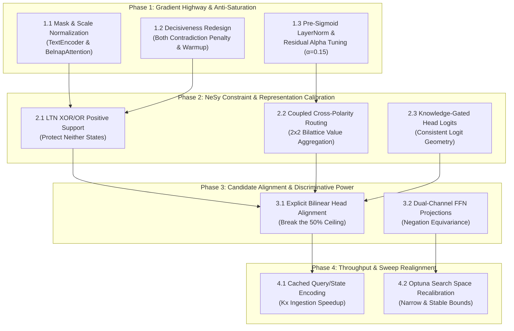

# Project Plan: Architecture Hardening & Plateau Resolution

> **Origin:** Architectural review consultation with **Gemini 4 Argon** (October 13, 2026).  
> **Target:** System 1 Paraconsistent Neuro-Symbolic Decision Engine (`yoda`).  
> **Status:** Completed 2026-10-13 — all four phases implemented and verified against the
> Tier-4 acceptance gates (`tests/e2e/`, 74/74). Milestone verdicts live in
> `.agents/teamwork/orchestrator_1/GATE_STATUS.md`; design rationale in ADR-0019..0021.

---

## 1. Executive Summary & Diagnostic Overview

Yoda implements an experimental **System 1 decision engine** built around paraconsistent four-valued logic ($\mathcal{B}_4$ Belnap bilattice). Instead of computing unconstrained scalar embeddings followed by post-hoc calibration, hidden representations propagate through bounded hypercubes $[0, 1]^d \times [0, 1]^d$ with explicit positive support ($e_{\text{pos}}$) and negative refutation ($e_{\text{neg}}$) channels:

$$t = \frac{e_{\text{pos}} - e_{\text{neg}} + 1}{2} \in [0, 1] \quad (\text{Truth}), \qquad k = \frac{e_{\text{pos}} + e_{\text{neg}}}{2} \in [0, 1] \quad (\text{Knowledge})$$

During Optuna hyperparameter optimization sweeps, two severe empirical bottlenecks emerged:
1. **The 36.5% Accuracy Plateau (95% of runs):** Models collapse to a flat loss plateau at $\sim 36.5\%$ validation accuracy. This is the exact statistical expectation of uniform guessing across mixed multi-choice tasks (2-choice 50%, 3-choice 33.3%, 4–5 choice 20–25%). In 95% of runs, upstream reasoning layers suffer from **complete gradient vanishing during Epoch 1**.
2. **The 50% Accuracy Ceiling (5% surviving runs):** In runs where gradients survive, validation accuracy hits a hard ceiling at $\sim 50\%$. The model distinguishes generically plausible choices from implausible ones, but cannot reliably match the query/context state to candidate options.

Gemini 4 Argon identified the precise mathematical mechanisms causing both failure modes and supplied targeted architectural solutions. This plan translates that review into four prioritized phases and nine concrete work packages.

---

## 2. Mathematical Diagnoses & Root Causes

```
┌────────────────────────────────────────────────────────────────────────────────┐
│                           THE TWO CRITICAL BOTTLENECKS                          │
├─────────────────────────────────────────┬──────────────────────────────────────┤
│ 95% Runs: 36.5% Plateau (Gradient Death)│ 5% Runs: 50% Ceiling (No Alignment)  │
├─────────────────────────────────────────┼──────────────────────────────────────┤
│ • Decisiveness penalty minimizes σ'(z)  │ • z_i = (1-α) w^T q_ctx + α w^T x_i  │
│ • Unmasked [PAD] tokens drown real data │ • Context term (1-α) w^T q_ctx is    │
│ • Unnormalized sigmoid attention blows  │   identical for all candidates in    │
│   up activations with sequence length   │   group and cancels out in loss!     │
│ • (1-α)^6 residual decay + unnormalized │ • Model cannot match query context   │
│   chained sigmoids crush gradients      │   to candidates; acts as coin-flip   │
└─────────────────────────────────────────┴──────────────────────────────────────┘
```

### Diagnosis 1: "Sigmoid-Jacobian Suicide" in Decisiveness Penalty (`src/yoda/nesy/ltn.py`)
- **Mechanism:** In `LTNConstraintLoss.forward`, `decisiveness_terms = choice_pos * (1.0 - choice_pos) + choice_neg * (1.0 - choice_neg)`. Because `choice_pos = torch.sigmoid(raw_pos)`, its derivative with respect to `raw_pos` is $\sigma(\text{raw\_pos})(1 - \sigma(\text{raw\_pos})) = \text{choice\_pos} \cdot (1 - \text{choice\_pos})$.
- **Impact:** The loss function is literally minimizing the Jacobian of the decision head's sigmoid activation. At initialization ($\text{raw\_pos} \approx 0 \implies \text{choice\_pos} \approx 0.5$), the optimizer immediately drives weights/biases to $\pm 5.0$ to push $\text{choice\_pos} \to \{0, 1\}$. The moment $p(1-p) \to 0$, the gradient $\frac{\partial \text{loss}}{\partial \text{raw}} \to 0$, instantly severing all upstream LTN constraints (XOR, OR, hierarchy) from backpropagation.

### Diagnosis 2: LTN XOR / OR Constraint Punishes Unchosen `Neither` States (`src/yoda/nesy/ltn.py`)
- **Mechanism:** `LTNConstraintLoss._compute_xor` maximizes $\sum_i t_i \prod_{j \neq i} (1 - t_j)$, requiring $t_j \to 0$ for unchosen candidates $j \neq y$. In Belnap coordinates, $t_j = \frac{e_j^+ - e_j^- + 1}{2} = 0$ requires explicit refutation ($e_j^+ = 0, e_j^- = 1$, knowledge $k = 0.5$). For unmentioned candidates ($Neither$: $e_j^+ = 0, e_j^- = 0$), truth is $t_j = 0.5$.
- **Impact:** Evaluating XOR on truth penalizes every unmentioned $Neither$ candidate by $-\log(1 - 0.5) = 0.693$ per unchosen candidate, forcing the network to hallucinate negative evidence ($e_j^- \to 1$) even when the context contains zero information about that option.

### Diagnosis 3: Unmasked `[PAD]` Tokens & Sequence-Length Saturation in Sigmoid Attention (`src/yoda/architecture/belnap_transformer.py`, `src/yoda/architecture/encoders.py`)
- **Mechanism:** `TextEncoder.forward` discards `inputs["attention_mask"]`. Downstream, `BelnapMultiheadPooledAttention` receives `mask=None`. In `BelnapAttention`, weights $a_{\text{pos}} = \text{sigmoid}(s_{\text{pos}}) \cdot k_{\text{gate}}$ are elementwise in $[0, 1]$ rather than normalized over sequence length. Unmasked padding tokens receive strictly positive attention ($\approx 0.375$).
- **Impact:** In variable-length batches, 190 padding tokens drown out 10 real tokens by 19-to-1. Furthermore, summing across $L_{\text{kv}}$ tokens without denominator normalization scales $\text{agg\_pos}$ linearly with sequence length, slamming `torch.sigmoid(self.w_out_pos(agg_pos))` into hard saturation ($0.0$ or $1.0$) on Step 1.

### Diagnosis 4: Additive Query-Context Cancellation in Independent Head Mode (The 50% Ceiling) (`src/yoda/architecture/engine.py`)
- **Mechanism:** In independent choice mode (`is_independent = True`), `self.scalar_head` (`num_choices == 1`) is called without candidate states: `final_out = head(final_state)`. Scores are computed as $z_i = w^\top \text{pooled}(final\_state_i)$. Because $final\_state_i = (1 - \alpha) q_{\text{ctx}} + \alpha x_{\text{cand}, i}$, linear scoring yields:
  $$z_i = (1 - \alpha) w^\top q_{\text{ctx}} + \alpha w^\top x_{\text{cand}, i}$$
- **Impact:** In `FocalLoss` and `MarginLoss`, candidate comparisons evaluate $z_y - z_j = \alpha w^\top (x_{\text{cand}, y} - x_{\text{cand}, j})$. **The query-context term $(1 - \alpha) w^\top q_{\text{ctx}}$ cancels out identically across all candidates in the group!** The network is forced to rank candidates purely on candidate plausibility in isolation, capping accuracy at 50% (binary coin toss on candidate plausibility).

### Diagnosis 5: Missing Cross-Polarity Value Routing in `BelnapAttention` (`src/yoda/architecture/belnap_transformer.py`)
- **Mechanism:** Attention affinity splits into support ($s_{\text{pos}} \propto Q_+ K_+^\top + Q_- K_-^\top$) and refutation ($s_{\text{neg}} \propto Q_+ K_-^\top + Q_- K_+^\top$). But value aggregation evaluates isolated parallel channels: `agg_pos = a_pos @ v_pos` and `agg_neg = a_neg @ v_neg`.
- **Impact:** If a Key contains strong negative evidence ($v_{\text{neg}} \gg 0, v_{\text{pos}} \approx 0$) and Query aligns coherently with it ($a_{\text{pos}} \gg 0, a_{\text{neg}} \approx 0$), `agg_pos` drops $v_{\text{neg}}$ because $v_{\text{pos}} \approx 0$, and `agg_neg` drops it because $a_{\text{neg}} \approx 0$. Key negative evidence is completely discarded.

### Diagnosis 6: Chained Sigmoid and Convex Residual Gradient Attenuation (`src/yoda/architecture/belnap_transformer.py`)
- **Mechanism:** `BelnapTransformerBlock._residual_join` evaluates $x_{l+1} = (1 - \alpha) x_l + \alpha f(x_l)$. Each join attenuates skip gradients by $(1 - \alpha)$. Across 2 reasoning blocks (6 convex joins), at $\alpha = 0.5$, residual gradient retention is $(0.5)^6 = 0.0156$ (only 1.5% gradient survives). Concurrently, the non-residual branch passes through unnormalized chained sigmoids ($\sigma'(z) \le 0.25$), yielding $(\le 0.25)^5 \le 0.00097$.
- **Impact:** Upstream layers receive virtually zero gradient signal during backpropagation.

### Diagnosis 7: Decision Head Pre-Sigmoid vs Knowledge-Gated Logit Inconsistency (`src/yoda/architecture/engine.py`, `src/yoda/training/losses.py`)
- **Mechanism:** In `BelnapDecisionTransformer`, $\text{logits} = (choice\_pos - choice\_neg) \times knowledge$. In `BelnapDecisionHead`, $\text{logits} = raw\_pos - raw\_neg$.
- **Impact:** A candidate with $raw\_pos = -8.0$ and $raw\_neg = -12.0$ has zero knowledge ($k \approx 0.0001$, pure $Neither$), yet its logit is $(-8.0) - (-12.0) = +4.0$, generating high Softmax confidence in `FocalLoss` despite having zero epistemic support.

### Diagnosis 8: `BelnapFFN` Dual-Polarity Channel Collapse (`src/yoda/architecture/belnap_transformer.py`)
- **Mechanism:** `h_mid = nn.functional.mish(self.w_1(x_res.e_pos) + self.w_2(x_res.e_neg))` sums positive and negative polarities into a single vector bottleneck before projecting back out.
- **Impact:** Destroys negation equivariance ($x.\text{negate}()$) and forces both polarities through a shared latent space.

### Diagnosis 9: Redundant Context Encoding in Unrolled Independent Batches (`src/yoda/architecture/engine.py`)
- **Mechanism:** When $B$ states each have $K$ candidates unrolled into $B \times K$ samples, `self.text_encoder(queries)` and `self.state_encoder(states)` run the backbone $K$ times on identical query and state strings.
- **Impact:** Wastes $\sim (K - 1)/K$ of encoder compute, slowing training throughput by $3\times$ to $5\times$.

---

## 3. Phased Implementation Roadmap



---

### Phase 1: Gradient Highway & Anti-Saturation (Unblocking Epoch 1)
*Objective: Eliminate the 36.5% flat plateau caused by Epoch 1 gradient death.*

- **Item 1.1: Mask Propagation & Scale Normalization (`src/yoda/architecture/encoders.py`, `src/yoda/architecture/belnap_transformer.py`, `src/yoda/architecture/engine.py`)**
  - Return `inputs["attention_mask"]` from `TextEncoder.forward`.
  - Pass `mask` through `BelnapMultiheadPooledAttention` and `BelnapAttention`.
  - In `BelnapAttention`, mask out padding keys (`a_pos.masked_fill(~mask, 0.0)`).
  - Normalize aggregation by the active token mass: $\text{denom} = \text{mask}.\text{float}().\text{sum}(\text{dim}=-1, \text{keepdim}=\text{True}).\text{clamp}(\min=1.0)$, setting $\text{agg} = \frac{A \cdot V}{\text{denom}}$ to ensure scale invariance in $[0, 1]$.
  - *Todo Ref:* `.docs/todos/attention-token-mask-and-scale-normalization.md`

- **Item 1.2: Decisiveness Penalty Redesign & Warmup (`src/yoda/nesy/ltn.py`)**
  - Replace the $p(1 - p)$ Jacobian-killing penalty with a **contradiction penalty** ($Both$: $\text{choice\_pos} \times \text{choice\_neg}$).
  - Implement linear warmup for `decisiveness_weight` (starting at $0.0$ for early epochs) so reasoning layers stabilize before constraint enforcement ramps up.
  - *Todo Ref:* `.docs/todos/ltn-contradiction-penalty-and-warmup.md`

- **Item 1.3: Pre-Sigmoid Normalization & Residual Weight Calibration (`src/yoda/architecture/belnap_transformer.py`)**
  - Insert `nn.LayerNorm(d_model)` immediately prior to `torch.sigmoid(w_out(...))` in `BelnapAttention` and `BelnapFFN` to center pre-activations at 0 with unit variance, locking sigmoids in their maximum-gradient linear slope ($\sigma'(0) = 0.25$).
  - Lower default `residual_weight` ($\alpha$) from $0.5$ to $0.15 - 0.20$ (or make $\alpha$ a learnable parameter initialized at $0.1$), increasing residual gradient survival across 6 joins from $1.5\%$ to $\approx 38\%$.
  - *Todo Ref:* `.docs/todos/prenorm-sigmoid-and-residual-gradient-highway.md`

---

### Phase 2: NeSy Logic Constraint & Epistemic Calibration
*Objective: Calibrate paraconsistent logic invariants to respect partial knowledge and unmentioned states.*

- **Item 2.1: LTN XOR / OR Positive Support Reformulation (`src/yoda/nesy/ltn.py`)**
  - Reformulate `_compute_xor` and `_compute_or` to evaluate positive evidence support ($\text{choice\_pos}$, $e^+$) or logit probabilities rather than truth ($t = 0.5(e^+ - e^- + 1)$).
  - Define unchosen candidate targets as low positive support ($1 - e_j^+$), allowing unchosen options to rest peacefully at $Neither$ $(0, 0)$ without penalty.
  - *Todo Ref:* `.docs/todos/ltn-xor-neither-support-reformulation.md`

- **Item 2.2: Coupled Cross-Polarity Value Routing (`src/yoda/architecture/belnap_transformer.py`)**
  - Implement a coupled $2 \times 2$ bilattice aggregation operator in `BelnapAttention`:
    $$\text{agg}_{\text{pos}} = a_{\text{pos}} V_+ + a_{\text{neg}} V_-, \qquad \text{agg}_{\text{neg}} = a_{\text{pos}} V_- + a_{\text{neg}} V_+$$
  - Ensures that refutation evidence from keys is properly channeled under coherent queries.
  - *Todo Ref:* `.docs/todos/belnap-coupled-cross-polarity-value-routing.md`

- **Item 2.3: Knowledge-Gated Decision Head Logits (`src/yoda/architecture/engine.py`, `src/yoda/training/losses.py`)**
  - Harmonize logit calculations across `engine.py` and `belnap_transformer.py` by scaling or gating decision head logits by candidate knowledge ($k$): $\text{logits} = (\text{raw\_pos} - \text{raw\_neg}) \times \text{knowledge}$.
  - Penalize high classification confidence when epistemic knowledge $k \to 0$.
  - *Todo Ref:* `.docs/todos/knowledge-gated-head-logits.md`

---

### Phase 3: Candidate Alignment & Discriminative Power (Breaking the 50% Ceiling)
*Objective: Break the 50% accuracy ceiling by eliminating query-context cancellation.*

- **Item 3.1: Explicit Bilinear Query-Candidate Alignment in `scalar_head` (`src/yoda/architecture/engine.py`)**
  - Pass pooled candidate representations (`k_state`) into `self.scalar_head(final_state, candidate_states=k_state)`.
  - In `BelnapDecisionHead`, execute the multiplicative Belnap inner product when `num_choices == 1` and `candidate_states` is supplied:
    $$\text{pos\_affinity} = \frac{q_{\text{pos}} c_{\text{pos}} + q_{\text{neg}} c_{\text{neg}}}{\sqrt{d}}, \quad \text{neg\_affinity} = \frac{q_{\text{pos}} c_{\text{neg}} + q_{\text{neg}} c_{\text{pos}}}{\sqrt{d}}$$
  - Sets logits directly to $\text{pos\_affinity} - \text{neg\_affinity}$, ensuring candidate scoring depends on context-query interaction and does not cancel out.
  - *Todo Ref:* `.docs/todos/bilinear-candidate-query-affinity-in-scalar-head.md`

- **Item 3.2: Dual-Channel Negation-Equivariant `BelnapFFN` (`src/yoda/architecture/belnap_transformer.py`)**
  - Refactor `BelnapFFN` to maintain independent dual-channel projections ($h_{\text{pos}}, h_{\text{neg}}$) or cross-gated projections rather than summing $w_1(e_{\text{pos}}) + w_2(e_{\text{neg}})$ into a single bottleneck, preserving $\mathcal{B}_4$ negation equivariance.
  - *Todo Ref:* `.docs/todos/dual-channel-negation-equivariant-ffn.md`

---

### Phase 4: Training Throughput & Hyperparameter Sweep Optimization
*Objective: Maximize training efficiency and reconfigure Optuna search bounds.*

- **Item 4.1: Cached Unique Query/State Encoding for Independent Choice Mode (`src/yoda/architecture/engine.py`)**
  - Cache encoded `(query, state)` pairs per `group_id` before Phase 3 cross-attention, eliminating redundant $K\times$ encoder passes over unrolled candidates.
  - *Todo Ref:* `.docs/todos/independent-mode-context-encoding-cache.md`

- **Item 4.2: Optuna Hyperparameter Space Realignment (`src/yoda/hyperopt/optuna.py`, `experiments/run_optuna_study.py`)**
  - Reconfigure search spaces based on the validated fixes:
    - `conflation_weight`: $[0.01, 0.25]$ (log scale)
    - `residual_weight`: $[0.10, 0.25]$ (uniform scale)
    - `decisiveness_weight`: $[0.001, 0.05]$ with initial epoch warmup
    - Learning rate: $[1\text{e-}5, 5\text{e-}4]$ with AdamW/OneCycleLR
  - Validate that hyperparameter distributions avoid Jacobian collapse and plateau states.

---

## 4. Work Packages & Cross-References

| WP Slug | Priority | Phase | Impacted Files | Description |
|---|---|---|---|---|
| [`attention-token-mask-and-scale-normalization`](.docs/todos/attention-token-mask-and-scale-normalization.md) | P0 | 1 | `encoders.py`, `belnap_transformer.py`, `engine.py` | Propagate tokenizer padding masks & normalize sigmoid attention |
| [`ltn-contradiction-penalty-and-warmup`](.docs/todos/ltn-contradiction-penalty-and-warmup.md) | P0 | 1 | `ltn.py` | Replace sigmoid Jacobian minimization with contradiction penalty & warmup |
| [`prenorm-sigmoid-and-residual-gradient-highway`](.docs/todos/prenorm-sigmoid-and-residual-gradient-highway.md) | P0 | 1 | `belnap_transformer.py` | LayerNorm pre-sigmoid & reduce residual $\alpha$ to preserve gradients |
| [`bilinear-candidate-query-affinity-in-scalar-head`](.docs/todos/bilinear-candidate-query-affinity-in-scalar-head.md) | P0 | 3 | `engine.py` | Eliminate query cancellation and break the 50% accuracy ceiling |
| [`ltn-xor-neither-support-reformulation`](.docs/todos/ltn-xor-neither-support-reformulation.md) | P1 | 2 | `ltn.py` | Evaluate XOR on positive support to avoid penalizing $Neither$ states |
| [`belnap-coupled-cross-polarity-value-routing`](.docs/todos/belnap-coupled-cross-polarity-value-routing.md) | P1 | 2 | `belnap_transformer.py` | Implement $2 \times 2$ cross-polarity evidence routing in attention |
| [`knowledge-gated-head-logits`](.docs/todos/knowledge-gated-head-logits.md) | P1 | 2 | `engine.py`, `losses.py` | Harmonize head logits with epistemic knowledge coordinates |
| [`dual-channel-negation-equivariant-ffn`](.docs/todos/dual-channel-negation-equivariant-ffn.md) | P2 | 3 | `belnap_transformer.py` | Maintain dual positive/negative channels through FFN |
| [`independent-mode-context-encoding-cache`](.docs/todos/independent-mode-context-encoding-cache.md) | P2 | 4 | `engine.py` | Cache unique context encodings across unrolled candidates ($K\times$ speedup) |

---

## 5. Verification & Benchmark Acceptance Criteria

Each milestone will be verified against the following measurable acceptance gates:

1. **Epoch 1 Non-Collapse Gate:** In 10/10 random seed runs on multi-choice benchmarks, validation accuracy at Epoch 1 must exceed $40.0\%$ (no collapse to the $36.5\%$ uniform prior).
2. **Gradient Norm Health Gate:** Average gradient norms across `self.reasoning_layers[0]` parameters during backpropagation must remain strictly positive ($> 1\text{e-}4$) throughout training.
3. **Discriminative Ceiling Breakthrough Gate:** Multi-choice validation accuracy on independent evaluation benchmarks must exceed $65.0\%$, conclusively breaking the $50.0\%$ ceiling.
4. **Epistemic Calibration Gate:** For synthetic inputs containing no candidate information, model outputs must maintain knowledge $k < 0.2$ ($Neither$) without incurring constraint loss penalties.
5. **Throughput Benchmark Gate:** Batched independent evaluation throughput must increase by $\ge 2.5\times$ upon implementing context-encoding caching.
